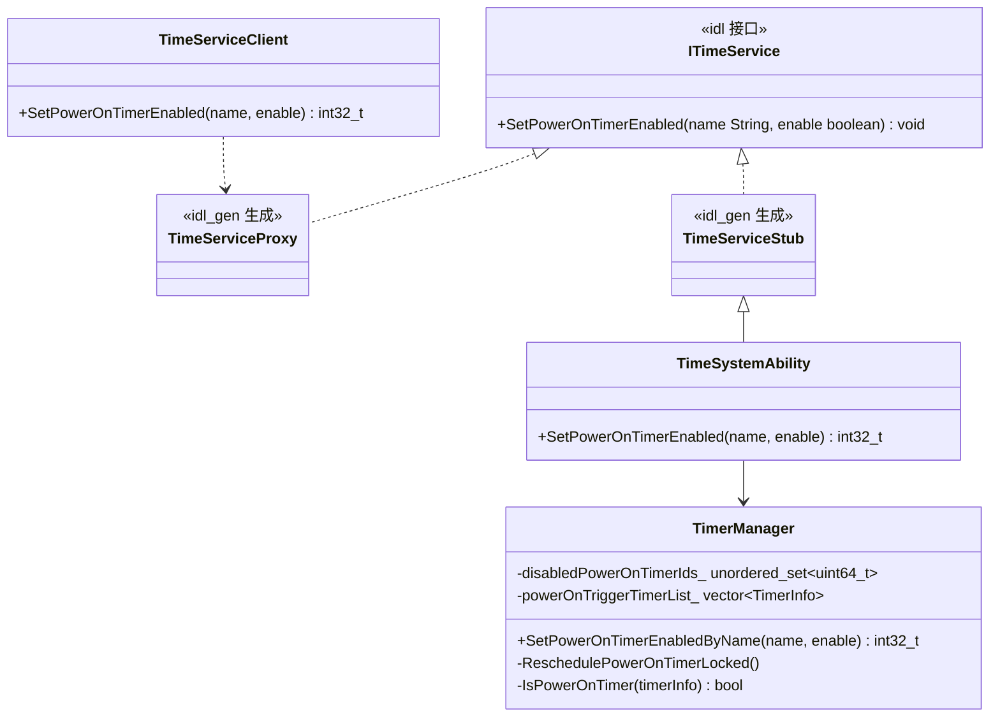
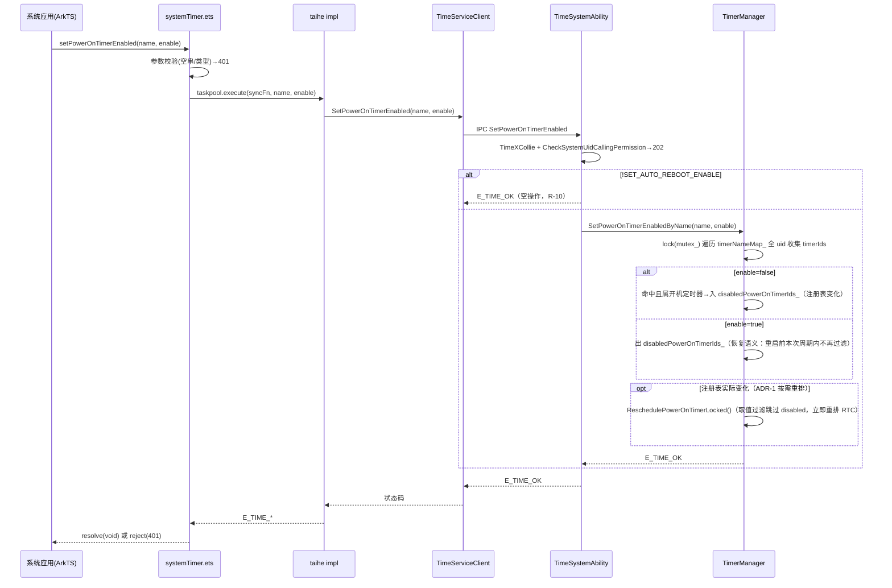
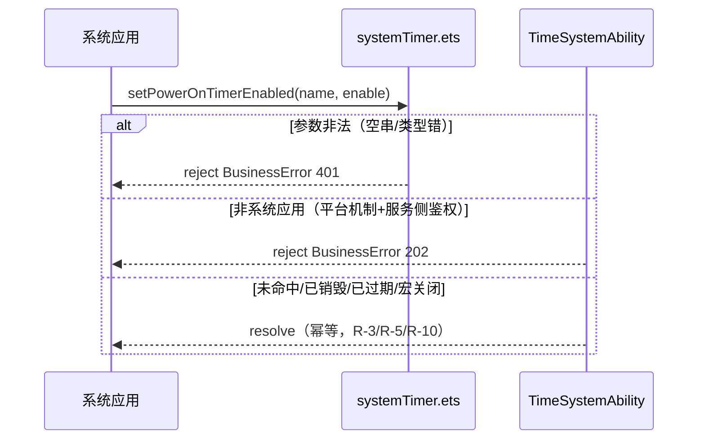

# 架构设计

## 设计元数据

| 字段 | 内容 |
|------|------|
| Design ID | DESIGN-20260921-01 |
| 关联需求 | `[proposal.md]`（Approved，digest 79181ac0…f50b66） |
| 关联 Epic | 无 |
| 目标 Feature | draft-20260921-set-poweron-timer-enabled |
| 复杂度 | 标准 |
| 目标版本 | OpenHarmony-7.1-Release（引用 proposal.target_release，proposed） |
| Owner | TBD（待需求方指定） |
| 状态 | Approved（2026-09-21 需求方批准；同日按内存态过滤方案重写 ADR-1/2/3 后再次确认） |

## 需求基线

> 需求基线详见 proposal.md。以下仅列出设计阶段需要额外强调的要点。

| 项 | 补充说明（如需） |
|----|------------------|
| 方案 A（调用即生效） | 已由需求方批准（proposal 附录 A-3）；本设计核对重排路径不被 ProxyTimer/空闲调整等机制覆盖（见 ADR-6 验证结论） |
| 控制语义（2026-09-21 需求方决策） | **仅本次运行周期生效**：enable/disable 状态为内存态，服务重启或设备重启后恢复原状；不改排序列表、不落盘 |
| 幂等静默成功 | 未命中、已销毁、已过期、宏关闭形态全部 resolve；仅参数错误（401）与非系统应用（202）拒绝 |

## 上下文和现状

### 涉及仓和模块

| 仓库 | 补充架构说明 |
|------|-------------|
| time_time_service | 三层 JS API 框架（NAPI/ANI/taihe 共享服务实现，AGENTS.md）；`services/ITimeService.idl` 经 `idl_gen_interface`（services/BUILD.gn:43-45）自动生成 Stub/Proxy；`TimeSystemAbility` 继承 `TimeServiceStub` 覆写虚方法；**本特性不新增 ANI 模块**：`@ohos.systemTimer` 由 taihe（`systemtimer_taihe_native`，IDL 生成绑定）完整承载（含存量 createTimer 等与本特性新增 setPowerOnTimerEnabled），ANI 仅绑定存量 systemDateTime 高频只读接口；taihe IDL 内每个函数声明 promise/sync（甚至 async）变体（先例：framework/js/taihe/system_timer/idl/ohos.time_service.systemtimer.taihe 的 CreateTimerPromise，且其 TimerOptions 已含 name 字段） |
| interface_sdk-js | 仅 api/@ohos.systemTimer.d.ts 声明变更（BasicServicesKit，2026-10-09 由 @ohos.systemDateTime 迁移），无实现代码 |

### 代码事实基线

| 代码引用（文件:行/符号） | 已验证事实 | 关联架构规则 | 对本设计的约束 | 验证来源/可信度 |
|-------------------------|------------|--------------|----------------|-----------------|
| `services/timer/src/timer_manager.cpp:666-691 / TimerManager::SetHandlerLocked` | 定时器（再）调度时，若 `IsPowerOnTimer(alarm)` 为真且不在 `powerOnTriggerTimerList_` 中则 push 并立即 `ReschedulePowerOnTimerLocked()`；已在列表则 no-op | OH-ARCH-LAYERING | **本设计不改此路径**：列表不含禁用语义，重复定时器重调度天然 no-op，无重入问题，looper 热路径零改动 | 源码，高 |
| `services/timer/src/timer_manager.cpp:967-1016 / ReschedulePowerOnTimerLocked` | 排序列表取最早未过期项设置 `POWER_ON_ALARM`；空列表/全过期时设十年后（"never trigger"）；`lastSetTime_[POWER_ON_ALARM]` 幂等去重 | OH-ARCH-LAYERING | **禁用过滤的唯一作用点**：取值写 RTC 时跳过 disabled 项（ADR-2）；重排入口唯一，幂等由既有逻辑保证 | 源码，高 |
| `services/timer/src/timer_manager.cpp:949-963 / DeleteTimerFromPowerOnTimerListById` | 按 timerId 从列表移除，找到才 `ReschedulePowerOnTimerLocked()`（条件重排先例）；仅在 `SET_AUTO_REBOOT_ENABLE` 内编译 | OH-ARCH-LAYERING | "注册表变化才重排"的按需模式先例（ADR-1） | 源码，高 |
| `services/timer/src/timer_manager.cpp:1038-1052 / TimerManager::SetLocked` | `POWER_ON_ALARM` 类型下 `when<=0` 不替换为 bootTime（宏内特殊分支），最终调 `handler_->Set(type, when, bootTime)` 直写定时器 handler | OH-ARCH-LAYERING | RTC 开机闹钟直写 handler，**不经过 alarmBatches_/ProxyTimer/空闲调整链路**——重排不会被其它机制覆盖（ADR-6 验证结论） | 源码，高 |
| `services/timer/src/timer_manager.cpp:216-232 / TimerManager::AddTimerName` | `timerNameMap_[uid][name]` 同名覆盖时返回旧 timerId 并替换映射；旧 timerId 从 nameMap 移除 | OH-ARCH-LAYERING | 跨 uid 按 name 查找以 `timerNameMap_` 为准；被覆盖的旧 timerId 不再匹配该 name（按 name 语义的必然结果，写入接口文档） | 源码，高 |
| `services/timer/include/timer_manager.h:147-152,187-190` | 开机定时器相关成员与方法均在 `#ifdef SET_AUTO_REBOOT_ENABLE` 内声明 | OH-ARCH-COMPONENT-BUILD | 新注册表成员与新方法遵循同一宏守卫；宏关闭形态由 TimeSystemAbility 层空操作（ADR-7） | 源码，高 |
| `services/time_system_ability.cpp:552-562 / DestroyTimer` | SA 入口模板：`TimeXCollie` 看门狗 + `CheckSystemUidCallingPermission` 鉴权 + 空指针检查 + 转调 TimerManager | OH-ARCH-IPC-SAF | 新 SA 方法逐行复用该模板（鉴权返回 `E_TIME_NOT_SYSTEM_APP`，JS 层映射 202） | 源码，高 |
| `services/time_permission.cpp:91-97 / CheckSystemUidCallingPermission` | = native/shell token 直接放行，否则 `TokenIdKit::IsSystemAppByFullTokenID` | OH-ARCH-IPC-SAF | 与"@systemapi 无 @permission"的 spec 定稿精确对齐：服务侧按"系统应用身份"校验 | 源码，高 |
| `services/timer/src/timer_database.cpp:52-54 / ALTER TABLE 先例` | `hold_on_reboot`/`drop_on_reboot` 加列走版本迁移 + `ALTER TABLE` | OH-ARCH-COMPONENT-BUILD | **本设计不使用**（ADR-3 决策：控制状态不落盘，DB 零变更）；记录此前提用于排除"持久化"备选方案的实现成本 | 源码，高 |
| `framework/js/ani/src/system_date_time_ani.cpp:107-119 / ANI_Constructor` | `ani_native_function` 数组 + `Namespace_BindNativeFunctions` 注册；native 直接调 `TimeServiceClient::GetInstance()` | OH-ARCH-LAYERING | **本特性不新增 ANI 模块**（ANI 仅存量 systemDateTime 高频只读绑定）；服务访问一律经 TimeServiceClient | 源码，高 |
| `framework/js/taihe/system_timer/idl/ohos.time_service.systemtimer.taihe / CreateTimerPromise` | 每个函数声明 `@promise` + `Sync` 变体（部分另有 `@async`）；`@!sts_inject` 注入 loadLibrary；TimerOptions 已含 `name: Optional<String>` | OH-ARCH-LAYERING | taihe 侧新增 `@promise` + `Sync` 两变体，遵循文件内先例 | 源码，高 |
| `interfaces/inner_api/libtime_client.map:79 / SetTimerExemption 导出符号` | TimeServiceClient 公开符号经 version script 导出 | OH-ARCH-COMPONENT-BUILD | 新客户端方法必须同步加入 .map，否则 ANI/taihe 链接失败 | 源码，高 |

### 调用链层级分析

| 层 | 模块 | 职责 | 修改类型 |
|----|------|------|----------|
| API 声明层 | interface_sdk-js `api/@ohos.systemTimer.d.ts` | systemapi 声明（@systemapi/@throws 202,401/@since 7.1） | 新增 |
| JS 框架层（taihe/ANI 运行时） | framework/js/taihe/system_timer（IDL + impl，生成 ANI 绑定） | taihe 生成桩 + impl 转调 TimeServiceClient；**不新增手写 ANI 模块** | 新增 |
| JS 框架层（taihe） | framework/js/taihe/system_datetime（IDL + impl） | taihe 生成桩 + impl 转调 TimeServiceClient | 新增 |
| 客户端层 | interfaces/inner_api（TimeServiceClient） | 客户端代理方法 + .map 导出 | 新增 |
| IPC 层 | services/ITimeService.idl → 生成 Stub/Proxy | idl_gen_interface 自动生成；TimeSystemAbility 覆写 | 新增 |
| 服务层 | services/time_system_ability.cpp | SA 入口：看门狗 + 鉴权 + 宏分支空操作 | 新增 |
| 服务核心层 | services/timer（TimerManager） | 跨 uid 匹配、禁用注册表、RTC 取值过滤、按需重排 | 新增 |
| 内核/handler 层 | TimerHandler（handler_->Set） | 直写 RTC 闹钟 | 无修改（仅经既有 SetLocked 调用） |

**检查项：**
- [x] 调用链每一层都已覆盖（API 声明 → taihe → client → IPC → SA → TimerManager → handler）
- [x] 每层职责边界清晰：JS 层只做参数校验与 Promise 语义，服务侧只做鉴权与转调，核心逻辑全部收敛在 TimerManager
- [x] 每层修改类型明确（均为新增，无存量行为修改）

### 适用架构规则

| Rule ID | 适用原因 | 设计结论 | 验证方式 |
|---------|----------|----------|----------|
| OH-ARCH-LAYERING | JS→client→SA→TimerManager 单向调用 | 严格单向：ANI/taihe 仅经 TimeServiceClient；SA 不直接操作注册表；TimerManager 不回调上层；**SetHandlerLocked 热路径零改动** | 代码评审 |
| OH-ARCH-SUBSYSTEM | 无跨子系统直接引用 | 仅 time 子系统内部 + access_token 等既有依赖不变 | 依赖检查 |
| OH-ARCH-IPC-SAF | 新增 IPC 方法 | IDL 声明 → idl_gen_interface 自动生成；鉴权在 SA 入口（CheckSystemUidCallingPermission） | 集成测试 |
| OH-ARCH-API-LEVEL | 新增 System API | @systemapi；无 @permission；错误码仅 202/401；@since 7.1；SysCap 沿用 SystemCapability.MiscServices.Time | API 评审/XTS |
| OH-ARCH-COMPONENT-BUILD | BUILD.gn/.map | 无新增编译单元（全部改既有文件）；libtime_client.map 加符号；**DB 无变更** | 构建验证 |
| OH-ARCH-ERROR-LOG | 错误码与日志 | 401/202 经既有错误码体系（E_TIME_PARAMETERS_INVALID / E_TIME_NOT_SYSTEM_APP）；命中数/生效数结构化日志（timerName 打点跟随现有 TIME_SIMPLIFY_HILOGI 惯例，不打印 WantAgent） | 单测/hilog |

### 既有模式复用

| 模式 | 参考代码（文件:行/符号） | 适用架构规则 | 必须复用的约定 | 本设计的复用方式 | 偏差及理由 | 关联 Task |
|------|-------------------------|--------------|------------------|------------------|------------|-----------|
| SA 入口模板 | time_system_ability.cpp:552-562 / DestroyTimer | OH-ARCH-IPC-SAF | TimeXCollie + CheckSystemUidCallingPermission + E_TIME_* 错误码 | 直接复用 | 无 | TASK-2 |
| 条件重排模式 | timer_manager.cpp:949-963 / DeleteTimerFromPowerOnTimerListById | OH-ARCH-LAYERING | "状态实际变化才重排" + mutex_ 内完成 | 直接复用（重排条件改为注册表变化，ADR-1） | 无 | TASK-1 |
| RTC 取值唯一入口 | timer_manager.cpp:967-1016 / ReschedulePowerOnTimerLocked | OH-ARCH-LAYERING | 排序+过期清理+十年后兜底+lastSetTime_ 幂等 | 扩展：取值循环中跳过 disabled 项（ADR-2） | 必要偏差：过滤插入点，语义见 ADR-2 | TASK-1 |
| taihe IDL 声明 + impl 转调 | taihe/system_timer/idl/ohos.time_service.systemtimer.taihe + impl.cpp | OH-ARCH-LAYERING | @promise + @Sync 双变体；impl 转调 TimeServiceClient + 401 错误映射 | 直接复用 | 无 | TASK-4 |
| taihe 函数声明 | taihe/system_timer/idl/ohos.time_service.systemtimer.taihe / CreateTimerPromise | OH-ARCH-LAYERING | @promise + @Sync 双变体、@rename | 直接复用 | 无 | TASK-5 |
| 客户端方法 | interfaces/inner_api/include/time_service_client.h:404-410 / SetTimerExemption | OH-ARCH-LAYERING | GetInstance() + IPC 同步调用 + .map 导出 | 直接复用 | 无 | TASK-2 |

## 不涉及项承接

| 维度 | 设计结论 |
|------|----------|
| 安全与权限（proposal=是） | 双层管控：SDK 层 @systemapi 隐藏（平台 202 机制）+ 服务侧 CheckSystemUidCallingPermission（映射 E_TIME_NOT_SYSTEM_APP→202）；无 @permission。详见"安全基础检查" |
| 兼容性（proposal=是） | 新增 API 不改存量；**无数据存储格式变更**（控制状态内存态不落盘，ADR-3）；宏关闭形态空操作（ADR-7） |
| API/SDK（proposal=是） | 声明落点 api/@ohos.systemTimer.d.ts（BasicServicesKit，2026-10-09 迁移）；@since 7.1；@arkts 1.1&1.2 沿用命名空间惯例；不进 Public SDK |
| IPC/跨进程（proposal=是） | ITimeService.idl 新增一行声明；自动生成 stub/proxy；无手工分发代码 |
| 构建与部件（proposal=是） | **taihe system_timer 扩展**（IDL/impl 增接口，无新编译单元）；libtime_client.map 加 1 符号；bundle.json 不变；**DB 版本不变、无新列** |

## 关键设计决策

| 决策 ID | 问题 | 推荐方案 | 探索过的替代方案 | 取舍理由 | 影响 |
|---------|------|----------|-----------------|------|------|
| ADR-1 | 重排时机 | **调用即生效 + 按需重排**：disable/enable 在 mutex_ 内完成注册表变更后，**仅当注册表实际变化时**调用 `ReschedulePowerOnTimerLocked()`（RTC 取值依赖注册表，过滤结果可能变化）；重复禁用已禁用项等幂等场景不重排 | ① 仅关机流程重排（proposal A-4，已放弃：异常关机时 RTC 仍是旧值，禁用失效）；② 无条件每次重排——未命中幂等调用白白写 RTC 寄存器，与 DeleteTimerFromPowerOnTimerListById 条件重排先例不一致，弃 | 需求方已批方案 A"避免其它业务机制导致重排未生效"；RTC 闹钟为硬件持久状态，注册表变化时立即重排才能保证异常关机路径下禁用生效；lastSetTime_ 幂等保证外部可观察行为一致 | AC-1.1/AC-1.3；TimerManager 新方法实现 |
| ADR-2 | 禁用语义的实现位置 | **不改排序列表，取值过滤**：`powerOnTriggerTimerList_` 结构与本特性的处理逻辑零改动；新增内存态 `disabledPowerOnTimerIds_`（`unordered_set<uint64_t>`，timerId 粒度）；`ReschedulePowerOnTimerLocked` 排序后**跳过 disabled 项**取第一个未过期项写入 RTC，全部被跳过/空列表 → 十年后 | ① 从列表移除+`SetHandlerLocked` 热路径拦截重入（初版设计）——改动 looper 热路径、需处理重复定时器重调度的重入、原子性复杂，弃；② name 粒度集合——无法区分同名不同定时器，弃 | 列表不动则重入问题天然消失（重调度时 find_if 已命中，no-op）；过滤点收敛在 RTC 取值唯一入口，行为可证；timerId 会话内唯一（随机生成），id 粒度精确无歧义 | AC-1.1/AC-1.5/AC-1.6；核心数据结构 |
| ADR-3 | 控制状态的生命周期与持久化 | **内存态，仅本次运行周期生效**：不落盘、无 DB 变更；服务重启或设备重启后注册表为空，所有定时器自动恢复原状（spec R-11 已按此修订） | ① 落盘跨重启保持（初版设计，DB 加列+版本迁移）——与需求方"每次重启后恢复原状"的语义直接冲突，弃；② 独立 disabled 表——同样跨重启，弃 | 需求方 2026-09-21 明确决策；零 DB 变更零迁移成本；重启恢复为零操作（无需 RecoverTimer 改造） | spec R-11（已回写）；无存储变更 |
| ADR-4 | ANI 层不新增模块，由 taihe 承载 | **取消手写 ANI 模块**：`@ohos.systemTimer` 由 taihe（IDL 生成绑定 + impl）完整承载（含存量 createTimer 等），本特性新增的 setPowerOnTimerEnabled 由 taihe impl 实现（转调 TimeServiceClient + AniUtils::ConvertErrorCode 401 映射）；ANI 仅保留存量 systemDateTime 高频只读绑定 | ① 手写 ANI 模块（初版：@ohos.systemTimer.ets + system_timer_ani.cpp）——与 taihe 生成物绑定同一 `@ohos.systemTimer` 命名空间，重复且运行时冲突，弃；② 无 | taihe 生成物已完整覆盖 @ohos.systemTimer 命名空间，ANI 新建为第三来源（NAPI/taihe 之外）的重复实现；401 由 taihe impl 侧 AniUtils::ConvertErrorCode（E_TIME_PARAMETERS_INVALID → 401）保证 | AC-1.8；taihe impl 实现 |
| ADR-5 | taihe 层同步范围 | IDL 新增 `@rename("setPowerOnTimerEnabled") @promise SetPowerOnTimerEnabledPromise(name: String, enable: bool): void;` + `SetPowerOnTimerEnabledSync(...)`；impl 转调 TimeServiceClient（JS 面 options 展开为双参数在 ets/声明层完成，taihe IDL 不变） | 仅 promise 变体——违背文件内"每函数 promise+sync 双变体"先例，弃 | 先例一致性；sync 变体供后续同步场景；options 演进不波及 IPC  ABI | taihe IDL/impl |
| ADR-6 | 方案 A 风险核对：重排是否会被其它机制覆盖 | 验证通过：`ReschedulePowerOnTimerLocked` → `SetLocked(POWER_ON_ALARM)` → `handler_->Set` 直写（timer_manager.cpp:1038-1052），不经 alarmBatches_（ProxyTimer/空闲调整只作用于 ELAPSED/RTC 批次，timer_manager.cpp:826-828 代理路径仅 ProxyTimer 自身重排）；`lastSetTime_` 幂等防重复写 | —（核验项，无备选） | 需求方关切"避免其它业务机制导致重排未生效"已用源码路径核实 | 关闭 proposal 风险表对应项 |
| ADR-7 | 宏关闭形态（SET_AUTO_REBOOT_ENABLE 未开启） | TimeSystemAbility 入口直接返回 `E_TIME_OK`（空操作，R-10）；TimerManager 新方法/新成员不编译（与既有宏守卫一致）；SA→TimerManager 调用点加宏分支 | ① 方法保留并内部空转——无谓编译面扩大，弃；② 返回能力不支持错误——spec R-10 已定静默成功，弃 | spec R-10 基线；编译面最小 | AC-1.9 |
| ADR-8 | 关机路径（非 CALLBACK_AUTOBOOT_ENABLE）的禁用过滤 | `SetAutoReboot`（关机时从 DB `hold_on_reboot` 直写 `POWER_ON_ALARM`）同样跳过 `disabledPowerOnTimerIds_`：DB 查询增加 `timerId` 字段，命中禁用集合则跳过（TimerManager 新增 `IsPowerOnTimerDisabled` 查询）；运行时重排（ReschedulePowerOnTimerLocked）与关机 DB 直写两条 POWER_ON_ALARM 写入路径均遵守禁用语义 | ① 仅运行时重排过滤（初版）——`CALLBACK_AUTOBOOT_ENABLE` 关闭的设备关机走 SetAutoReboot DB 直写，绕过禁用集合，实测"禁用后仍拉起"（AC-1.1 失效），弃；② 无 | 两种宏形态（CALLBACK_AUTOBOOT_ENABLE 开/关）都必须满足 AC-1.1；ADR-2"过滤点收敛在唯一入口"的假设需扩为"两条写入路径均过滤" | AC-1.1；SetAutoReboot + IsPowerOnTimerDisabled |

## 设计骨架

### 骨架范围

| 骨架项 | 目标 | 不包含 | 验证方式 |
|--------|------|--------|----------|
| API/接口骨架 | d.ts 声明 + IDL 声明 + TimeServiceClient/SA/TimerManager 空实现签名（直接返回 E_TIME_OK） | 注册表/过滤/重排逻辑 | d.ts 编译 + IDL 生成 + 部件编译通过 |
| 模块骨架 | disabledPowerOnTimerIds_ 成员与取值过滤桩 | 行为正确性 | 单测可构造 TimerManager |
| 测试骨架 | gtest 用例 fixture（创建开机定时器→调用→断言） | 全场景 | 骨架用例编译并可运行（Red） |

### 骨架 Spec 拆分

| Task ID | 目标 | 受影响文件 | AC |
|---------|------|------------|-----|
| TASK-SKELETON-1 | 建立全链路接口骨架：d.ts 声明、IDL 声明、client/SA/TimerManager 签名、taihe 桩 | proposal.md 影响范围表所列文件（plan 阶段展开精确清单） | WHEN 骨架完成 THEN 部件编译通过、JS 侧可 import 该 API、调用返回 E_TIME_OK（空实现） |

## 后续 Task 拆分

| Task ID | 目标 | 受影响文件 | 依赖 |
|---------|------|------------|------|
| TASK-1 | TimerManager 核心：跨 uid 按 name 匹配 + disabledPowerOnTimerIds_ 注册表 + ReschedulePowerOnTimerLocked 取值过滤（跳过 disabled）+ 按需重排 + 过期判断 | services/timer/include/timer_manager.h、services/timer/src/timer_manager.cpp | TASK-SKELETON-1 |
| TASK-2 | IPC 链路：ITimeService.idl 声明、TimeServiceClient 方法 + .map、TimeSystemAbility 入口（看门狗+鉴权+宏分支空操作） | services/ITimeService.idl、interfaces/inner_api/*、services/time_system_ability.cpp/.h | TASK-SKELETON-1 |
| TASK-3 | 可观测性与重启语义：dump 展示注册表与最近 RTC 设置值（支撑 VM-1 验证入口）；重启后控制自动解除的集成用例 | services/dfx/、test/unittest/service_test/* | TASK-1 |
| TASK-4 | ~~ANI 层新建 @ohos.systemTimer 模块~~（已取消，ADR-4：taihe 已完整承载，ANI 不新增） | — | TASK-2 |
| TASK-5 | taihe 层：IDL 声明 setPowerOnTimerEnabled + impl 转调 TimeServiceClient + 401 映射（唯一语言面承载） | framework/js/taihe/system_timer/idl/ohos.time_service.systemtimer.taihe、src/ohos.time_service.systemtimer.impl.cpp | TASK-2 |
| TASK-6 | d.ts 声明 + 测试补齐（gtest 幂等矩阵/多 uid/过滤、JS 功能测试、关机集成） | interface_sdk-js/api/@ohos.systemTimer.d.ts、test/unittest/service_test/* | TASK-1~5 |

## API 签名、Kit 与权限

### 新增 API

| API 签名 | 类型 | Kit | d.ts 位置 | 权限要求 | SysCap |
|----------|------|-----|-----------|----------|--------|
| `function setPowerOnTimerEnabled(options: PowerOnTimerEnabledOptions): Promise<void>;` | System | BasicServicesKit（@ohos.systemTimer 命名空间所属 Kit，2026-10-09 由 SystemDateTime Kit 迁移） | `interface_sdk-js/api/@ohos.systemTimer.d.ts` | 无（@systemapi + 服务侧系统应用身份校验） | SystemCapability.MiscServices.Time |

JSDoc 关键注解：`@systemapi Hide this for inner system use`、`@throws 202/401`、`@since 7.1`、`@arkts 1.1&1.2`、`@crossplatform`（沿用命名空间头部惯例，以 API 评审为准）。

`PowerOnTimerEnabledOptions` 随函数同文件声明：`interface PowerOnTimerEnabledOptions { timerName?: string; enable?: boolean; }`（timerName 可选、缺省时操作应用于所有 power-on 定时器，存在则非空且 ≤64 字节；enable 可选、缺省默认 true；**options 整体缺省时启用所有"可在关机后启动设备的定时器"**，2026-10-24 修订；2026-10-08 由位置参数改为 options 对象，扩展字段随 `@since` 演进、本期不声明预留字段）。

### 变更/废弃 API

| 原有 API | 变更类型 | 新 API | 迁移说明 |
|----------|----------|--------|----------|
| N/A：无变更/废弃（仅新增） | — | — | — |

## 构建系统影响

### BUILD.gn 变更

```
framework/js/ani/BUILD.gn：**无变更**（2026-10-22 修订：取消 ANI 新建模块，taihe 完整承载，ANI 不新增 target/abc/package）
其余改动仍在既有编译单元（timer_manager.cpp、time_system_ability.cpp、time_service_client.cpp、
taihe system_timer impl cpp）与声明文件（IDL/.taihe/d.ts/.h）；idl_gen_interface 与 taihe IDL 生成
自动吸收声明变更。

注册说明：bundle.json 不注册 ANI target（存量 systemdatetime_ani 亦不在 bundle.json），
本特性不新增 ANI 编译单元，无注册条目。
```

### 其它构建面变更

```
interfaces/inner_api/libtime_client.map: 新增 TimeServiceClient::SetPowerOnTimerEnabled 导出符号
DB/ bundle.json: 无变更（控制状态内存态不落盘，ADR-3）
```

### bundle.json 变更

无。

---

## 可选设计扩展

### 架构图

```
系统应用(ArkTS)
  └─ taihe 路径: taihe 生成桩 ──► ohos.time_service.systemtimer.impl.cpp（唯一语言面承载，NAPI/taihe 双来源）
                          │ 均经 TimeServiceClient（libtime_client.so，.map 导出）
                          ▼
        IPC ──► TimeServiceStub(生成) ──► TimeSystemAbility
                    （TimeXCollie + CheckSystemUidCallingPermission）
                          ▼
        TimerManager（mutex_）
          ├─ timerNameMap_[uid][name] ──► timerEntryMap_
          ├─ disabledPowerOnTimerIds_（新，内存态，重启即清空）
          └─ powerOnTriggerTimerList_（不改）──► ReschedulePowerOnTimerLocked
                                        （取值时跳过 disabled）──► SetLocked(POWER_ON_ALARM)
                                        └─► handler_->Set → RTC
宏关闭形态（!SET_AUTO_REBOOT_ENABLE）：TimeSystemAbility 入口直接返回 E_TIME_OK
```

### 类图



| 类型/接口 | 现有代码引用或 New | 关系 | 关键职责/签名 | 关联 ADR | 关联 Task |
|-----------|--------------------|------|---------------|----------|-----------|
| `ITimeService` | `services/ITimeService.idl:39` 先例 / 修改 | idl 接口 | 新增 `SetPowerOnTimerEnabled([in] String name, [in] boolean enable)` | ADR-1 | TASK-2 |
| `TimeServiceProxy`/`TimeServiceStub` | idl_gen_interface 生成（services/BUILD.gn:43-45） | 生成 | 随 IDL 自动生成，无手工代码 | ADR-1 | TASK-2 |
| `TimeSystemAbility::SetPowerOnTimerEnabled` | New | 覆写 stub 虚方法 | 看门狗+鉴权+宏分支+转调 TimerManager | ADR-1/ADR-7 | TASK-2 |
| `TimeServiceClient::SetPowerOnTimerEnabled` | New | 客户端代理 | 同步 IPC；导出 .map | ADR-1 | TASK-2 |
| `TimerManager::SetPowerOnTimerEnabledByName` | New | 核心逻辑 | 跨 uid 匹配/注册表维护/按需重排；宏守卫 | ADR-1/2/3 | TASK-1 |
| `TimerManager::disabledPowerOnTimerIds_` | New 成员 | 状态 | 禁用注册表（内存态） | ADR-2/3 | TASK-1 |
| `TimerManager::ReschedulePowerOnTimerLocked` | timer_manager.cpp:967-1016 / 修改 | 既有方法扩展 | 取值循环跳过 disabled 项（唯一过滤点） | ADR-2 | TASK-1 |

### 数据流/控制流

| 步骤 | 调用方 | 被调用方 | 数据/接口 | 说明 |
|------|--------|----------|-----------|------|
| 1 | 系统应用 | systemTimer.ets | `setPowerOnTimerEnabled(name, enable)` | Promise 入口，ets 参数校验 |
| 2 | ets | native/TimeServiceClient | `SetPowerOnTimerEnabledSync` / IPC | taskpool 异步执行 |
| 3 | Stub | TimeSystemAbility | `SetPowerOnTimerEnabled(name, enable)` | 鉴权+宏分支 |
| 4 | TimeSystemAbility | TimerManager | `SetPowerOnTimerEnabledByName(name, enable)` | 持 mutex_ 的核心操作 |
| 5 | TimerManager | timerNameMap_ | 遍历全部 uid 的 name→id | 收集候选 timerId 集合 |
| 6 | TimerManager | disabledPowerOnTimerIds_ / timerEntryMap_ | 按 enable 分支处理 | disable：命中开机定时器→入集；enable：出集（满足条件与否都出集） |
| 7 | TimerManager | ReschedulePowerOnTimerLocked（注册表实际变化时） | POWER_ON_ALARM | 调用即生效（ADR-1 按需重排） |
| 过滤 | ReschedulePowerOnTimerLocked 内部 | disabledPowerOnTimerIds_ | `find(id)` | 排序后取值时跳过 disabled 项，取第一个未过期非禁用项；全跳过→十年后（ADR-2 唯一过滤点） |

### 时序设计



**关键语义说明：**
- **disable 后不立即写 RTC 会怎样**：RTC 中仍是旧最早值 → 必须立即重排（方案 A）；过滤后若最早非禁用项与当前 RTC 值相同，`lastSetTime_` 幂等跳过实际写
- **enable=true 的恢复语义**：出集即恢复——不再过滤该定时器；若其触发时间未过期，重排后重新参与 RTC 取值（无需"加入列表"动作，列表从未移除过它）
- **重复定时器触发**：HandleRepeatTimer → SetHandlerLocked → find_if 命中已在列表 → no-op，注册表不受扰动（ADR-2 不重入的根本理由）

### 数据模型设计

**无 DB 变更（ADR-3）。** 控制状态纯内存态：

| 数据类型 | 存储方式 | 位置 | 生命周期 |
|----------|----------|------|----------|
| disabledPowerOnTimerIds_ | 内存（unordered_set） | TimerManager 成员（宏守卫内） | 进程生命周期；服务重启/设备重启后为空 = 恢复原状（R-11） |

### 状态归属与不变量

#### 状态归属

| State ID | 状态/资源 | 唯一 Owner | 存储/Key/Index | 创建与初始化 | 读取/更新方 | 清理/恢复/回滚触发 | 并发模型 | 代码事实/规则来源 |
|----------|-----------|------------|----------------|--------------|-------------|--------------------|----------|-------------------|
| STATE-1 | powerOnTriggerTimerList_ | TimerManager | 成员 vector | SA 启动即存在（空） | SetHandlerLocked 写；Reschedule/Delete 删改 | timerEntryMap_ 条目移除时同步清理 | mutex_ 保护 | timer_manager.cpp:987 / timer_manager.h:189 |
| STATE-2 | disabledPowerOnTimerIds_（New） | TimerManager | 成员 unordered_set | SA 启动即存在（空）；重启后为空即"恢复原状" | SetPowerOnTimerEnabledByName 写；ReschedulePowerOnTimerLocked 读 | 定时器销毁（RemoveLocked）时同步擦除 id（卫生项）；进程退出即消失 | mutex_ 保护 | New，ADR-2/3 |
| STATE-3 | RTC 开机闹钟（POWER_ON_ALARM） | TimerHandler（内核侧） | handler_ 直写 | 初始设置（重排时更新） | ReschedulePowerOnTimerLocked 写 | 无有效项→十年后 | mutex_ → SetLocked | timer_manager.cpp:1038-1052 |

#### 不变量追溯

| Invariant ID | State ID / 范围 | 必须始终成立的约束 | 关联 AC | 关联 Task | 验证方式与通过标准 | 违反时处理 |
|--------------|------------------|--------------------|---------|-----------|--------------------|------------|
| INV-1 | STATE-2 → STATE-3 | id 在 disabledPowerOnTimerIds_ 中时，不得成为写入 RTC 的取值（Reschedule 过滤保证） | AC-1.1 | TASK-1 | 单测：禁用后断言 RTC 设置值不含该定时器时间（dump/lastSetTime_ 可读） | 过滤跳过并写 warn 日志 |
| INV-2 | STATE-2 → STATE-3 | 注册表变化必须同临界区内完成 ReschedulePowerOnTimerLocked（调用即生效） | AC-1.1/AC-1.3 | TASK-1 | 单测：禁用最早项后断言 lastSetTime_ 更新为下一非禁用项或十年后 | 补重排；新增回归用例 |
| INV-4 | 全局 | 同名多 uid 单次调用全部生效，无部分生效中间态（单次 mutex_ 临界区完成全部匹配项） | AC-1.5 | TASK-1 | 单测：两 uid 同名，断言两项同态 | 临界区保证；并发测试 |
| INV-5 | 全局 | 被禁用定时器在设备开机状态下的触发行为与未禁用时完全一致（只影响 RTC 取值） | AC-1.1 | TASK-1 | 单测：禁用后正常触发回调 | 过滤仅限 Reschedule 取值路径 |
| INV-6 | STATE-2 | 定时器销毁时其 id 从注册表擦除（卫生项，防集合无限增长） | AC-1.4 | TASK-1 | 单测：销毁后注册表无残留 id | RemoveLocked 处同步 erase |

### 线程与并发模型

| 操作 | State ID / 竞争对象 | 发起线程 | 回调线程 | 跨进程边界 | 同步/所有权机制 | 锁顺序/重入约束 | 关联不变量 |
|------|---------------------|----------|----------|------------|----------------|----------------|------------|
| SetPowerOnTimerEnabledByName | STATE-2/3 | Binder 线程 | 无回调（同步 IPC） | 是 | mutex_ 单锁临界区 | 注册表变更与重排同临界区；不新增其它锁 | INV-2/INV-4 |
| ReschedulePowerOnTimerLocked（取值过滤） | STATE-1/2/3 | Binder 线程 / alarmThread_ | — | 否 | mutex_（既有） | 过滤为只读查表，无新增锁 | INV-1/INV-2 |
| RemoveLocked（销毁清理） | STATE-2 | alarmThread_ / Binder | — | 否 | mutex_（既有） | 同步 erase 注册表 id | INV-6 |

**并发场景：**

| 场景 | 竞争对象 | 保护机制 | 预期行为 | 关联 AC/Task | 验证方式 |
|------|----------|----------|----------|-------------|----------|
| 并发 enable/disable 同名 | STATE-2/3 | mutex_ 串行化 | 后到的调用基于先到结果继续，最终态一致；注册表变更与 RTC 重排同临界区（INV-2/INV-4） | AC-1.5 / TASK-1 | 并发单测（线程对拍）+ TSAN |
| 禁用与定时器触发并发 | STATE-1/2/3 | mutex_ | 过滤判定在锁内，触发回调照常，不产生半态（INV-1/INV-5） | AC-1.1 / TASK-1 | 并发单测 + TSAN |
| 禁用与定时器销毁并发 | STATE-2 | mutex_ | 销毁路径同步擦除注册表 id，注册表无泄漏残留（INV-6） | AC-1.4 / TASK-1 | 并发单测 |
| 重启后并发调用 | STATE-2 | mutex_ | 注册表为空 = 全部恢复，调用按新状态生效 | AC-1.1 / TASK-3 | 重启集成用例 |

### 测试性设计

| 测试层级 | 测试目标 | Mock 策略 | 验证方式 |
|----------|----------|-----------|----------|
| 单元测试（gtest） | 幂等矩阵（R-3/5/6/7）、RTC 取值过滤（INV-1）、多 uid（AC-1.5）、销毁清理（INV-6）、按需重排（INV-2） | Mock TimerHandler（参照 test/unittest/service_test/time_service_timer_test.cpp 既有 fixture）；注册表与 lastSetTime_ 经 dump/测试钩子可读 | `hb build --product-name=rk3568 --build-target time_service_test` |
| 集成测试 | disable→关机→不启动；enable→恢复→启动（AC-1.1/AC-1.3 终端用户面）；重启后控制解除（R-11） | 真实依赖 | 设备集成测试 |
| XTS/JS 功能 | 202（非系统应用）、401（参数非法） | N/A | Hypium 用例 |
| 宏关闭形态冒烟 | R-10 空操作 | N/A | 对应产品形态构建冒烟 |

### 异常传播时序图



| 异常场景 | 触发层 | 传播路径 | 最终处理 |
|----------|--------|----------|----------|
| 参数非法 | ets/native | ets 校验/native 返回码 → ets 组 BusinessError | reject 401（AC-1.8） |
| 非系统应用 | 平台机制 / SA 鉴权 | SA 返回 E_TIME_NOT_SYSTEM_APP → client → native → ets | reject 202（AC-1.7） |
| 未命中/失效 | TimerManager | 正常返回 E_TIME_OK | resolve（AC-1.2/AC-1.4/AC-1.9） |
| 服务重启/设备重启 | SA 框架 | 注册表随进程消失 | 恢复原状，resolve 语义不变（R-11） |

### 接口参数规约

| 接口 | 参数 | 类型 | 合法范围 | 非法处理 | 边界说明 |
|------|------|------|----------|----------|----------|
| setPowerOnTimerEnabled | options | PowerOnTimerEnabledOptions | 非空对象 | 缺失/非 object → 401 | options 形态为扩展承载面；本期仅 timerName/enable 两个必填字段 |
| setPowerOnTimerEnabled | options.timerName | string | 非空且长度 ≤64 字节（含未命中名称） | 空串/非 string/超 64 字节 → 401 | 64 字节上限与 @ohos.systemTimer createTimer name 约束（NAPI STR_MAX_LENGTH=64）一致；未命中名称合法且静默成功（R-3） |
| setPowerOnTimerEnabled | options.enable | boolean | true/false | 非 boolean/缺失 → 401 | 多传 callback 参数 → 401（无该重载） |

**选择器演进规则（2026-10-08 增补）**：本期 options 仅 `timerName` 一个必填选择器；未来新增选择器类字段（如 `timerId`）一律可选，`timerName` 按 `@since` 放宽为可选，统一校验规则为：① 至少一个选择器（全部缺失 → 401）；② 多选择器为 AND 语义（同时命中全部条件才管控）；③ 必填→可选放宽不视为语义破坏；④ `enable` 恒必填。本期 IDL/IPC/客户端维持 (name, enable) 双参数不变；未来引入第二选择器时，IDL 演进方式（新增重载/方法或扩展参数）由该版本 design 阶段按当时 ABI 约束决策，本规则保证 JS 面校验语义先行稳定。

### 安全基础检查

#### 信任边界交叉分析

| 边界类型 | 跨越的交互 | 风险 | 约束 |
|---|---|---|---|
| 沙箱内外（应用→SA IPC） | 系统应用经 IPC 调用 setPowerOnTimerEnabled | 非系统应用越权管控开机任务 | 双层校验：@systemapi 平台 202 机制 + 服务侧 CheckSystemUidCallingPermission（time_permission.cpp:91-97）；拒绝返回 E_TIME_NOT_SYSTEM_APP |
| 用户态/内核态 | handler_->Set 写 RTC 闹钟 | 错误闹钟导致误开机/不开机 | 仅经 ReschedulePowerOnTimerLocked 既有路径；lastSetTime_ 幂等；列表排序逻辑不改 |
| 本地/远程 | 无远程入口 | N/A | — |
| 不同 SELinux 域 | 无新增域交叉 | N/A | — |

#### 基础安全要求

| 检查项 | 结论 | 说明/措施 |
|---|---|---|
| 加密算法(OH 推荐) | N/A | 无加密需求 |
| 密钥管理 | N/A | 无密钥 |
| 随机数 | N/A | timerId 生成沿用既有随机引擎，本特性不新增 |
| 输入验证 | 是 | options 非空对象、timerName 非空且 ≤64 字节、enable 类型双侧（ets/native）校验 → 401；服务端不假设 JS 层已校验 |
| 错误处理 | 是 | 鉴权失败/参数错误返回既有 E_TIME_* 码；控制状态无持久化，无数据损坏面 |
| 配置 | N/A | 无新增可配置项 |
| 敏感数据处理(传输/存储/日志) | 是 | 日志仅打印 timerName（跟随现有打点惯例）与命中数量；不打印 WantAgent/回调内容；无新增存储 |

### 深度威胁分析(如需)

不产出 threat-model.md。判据核对：不涉及敏感数据/网络暴露面/权限与鉴权体系变更/合规要求；攻击面为"已可调用 systemapi 的系统应用"，管控强度与既有 DestroyTimer/SetTimerExemption 同级（同一鉴权函数），无新增风险类别。若 SIG 安全评审认定开机管控属关键基础设施，再升级 ohos-security-threat-model 补产。

## 风险和开放问题

| 项 | 类型 | 影响 | 处理方式 | Owner |
|----|------|------|----------|-------|
| spec R-11/兼容性声明已按 ADR-3（内存态）回写修订（2026-09-21） | 规格一致性 | 中 | 已同步（spec.md R-11/VM-11/兼容性/状态行） | 需求方+Agent |
| 2026-10-08 基线修订：JS 面签名改 options 对象 + timerName ≤64 字节（超限 401）+ 选择器演进规则（至少一个选择器/AND 语义/timerName 未来放宽可选） | 规格一致性 | 中 | 已同步 spec.md（状态行/AC-1.8/R-9/API 事实/接口规格/VM-9/扩展性约定）与本文件（ADR-4/ADR-5/签名表/参数规约）；IDL/IPC/客户端双参数链路不变；proposal baseline_digest 待重跑 approval-digest | 需求方+Agent |
| 2026-10-09 基线修订：声明落点 @ohos.systemDateTime → @ohos.systemTimer；options 接口名 Set 前缀去除（→ PowerOnTimerEnabledOptions） | 落点正确性/构建面 | 中 | 已同步 spec.md/proposal.md/execution-plan.md 与本文件（上下文/影响维度/任务拆分/API 表/BUILD.gn 节/时序图）；ANI 由"修改既有文件"改为"新建 systemTimer 模块 + BUILD.gn 新增 target"；待重跑 approval-digest | 需求方+Agent |
| @ohos.systemTimer 存量公开 API 由 NAPI 模块（framework/js/napi/system_timer）承载，本特性不含 NAPI 同步 | 兼容性/可达性 | 中 | design 挂接项：实现前确认目标产品形态的 JS 运行时加载 ANI/taihe 路径可达 @ohos.systemTimer 命名空间；若存在仅 NAPI 形态产品，需评估补 NAPI 声明或调整落点 | 需求方+Agent |
| 语言面由 taihe 单一承载（NAPI 为存量公开 API 承载；ANI 不新增，2026-10-22 修订见下） | 构建/测试 | 低 | 仅 taihe 层（IDL/impl）实现；NAPI 存量不变 | Agent |
| 2026-10-22 修订：取消 ANI 新建模块，`@ohos.systemTimer` 由 taihe 完整承载 | 构建面收敛/消除同名冲突 | 中 | 已同步本文件（ADR-4/TASK-4/BUILD.gn 节/时序图/调用链）；删除 framework/js/ani 的 systemtimer_ani target、ets/@ohos.systemTimer.ets、src/system_timer_ani.cpp；spec.md 同步 | 需求方+Agent |
| 2026-10-22 修复：SetAutoReboot 关机路径（非 CALLBACK_AUTOBOOT_ENABLE）接入禁用过滤 | 行为正确性 | 中 | 已同步本文件（ADR-8）；实测发现 SetAutoReboot DB 直写绕过禁用集合致"禁用后仍拉起"（AC-1.1 失效），新增 IsPowerOnTimerDisabled + DB 查询带 timerId 过滤 | 需求方+Agent |
| 2026-10-24 修订：PowerOnTimerEnabledOptions 字段改可选（timerName 缺省时操作应用于所有 power-on 定时器；enable 缺省默认 true）+ options 整体缺省时启用所有（enable all） | 接口可扩展性/语义 | 中 | 已同步本文件（参数规约）、spec.md（R-9/AC-1.8/AC-1.9/接口表）、taihe IDL/impl、NAPI、d.ts、doc；实现：TimerManager 空 name 支持 enable/disable all，语言面 options/timerName 可选 | 需求方+Agent |
| 同名 timer 被 AddTimerName 覆盖后，旧 timerId 不再按 name 匹配（代码事实基线 #5） | 语义边界 | 低 | 属"按 name 匹配"的自然语义；写入接口文档（d.ts 注释） | Agent |
| `@since` 具体版本标注（7.1 还是 API 级别号）以 API 评审结论为准 | API | 低 | d.ts 评审时定稿 | 需求方 |

## 设计审批

- [x] 需求基线已确认，设计覆盖 P0 AC（AC-1.1~AC-1.9 全部分配至 ADR/Task/不变量）
- [x] 不涉及项已承接，N/A 和展开项都有结论
- [x] 涉及仓和模块职责清楚
- [x] 调用链层级分析完整（8 层），每层覆盖到位
- [x] 代码事实基线使用文件:行/符号引用，每项事实已转化为设计约束
- [x] 既有模式复用已记录（7 项直接复用，无既有实现先例缺口）
- [x] 适用架构规则已识别并形成设计结论（6 条）
- [x] 分层和子系统边界合规（单向依赖，无跨层；SetHandlerLocked 热路径零改动）
- [x] 类图与代码事实、ADR、Task 一致
- [x] 状态 Owner 唯一，生命周期/恢复/锁模型无冲突（STATE-1~3，INV-1/2/4/5/6）
- [x] 每项 INV 均关联 AC、Task 和可执行验证方式
- [x] API 变更有签名、权限（无）、错误码（202/401）和兼容性说明
- [x] BUILD.gn/bundle.json/.map 影响明确（DB 无变更）
- [x] 设计输出和后续 Task 拆分明确（TASK-SKELETON-1 + TASK-1~6）
- [x] 关键设计决策有理由和 2-3 个备选（ADR-1~7）
- [x] 风险和开放问题有 Owner

**结论:** 通过（2026-09-21 需求方批准；spec R-11 挂接项已按内存态方案回写关闭）
