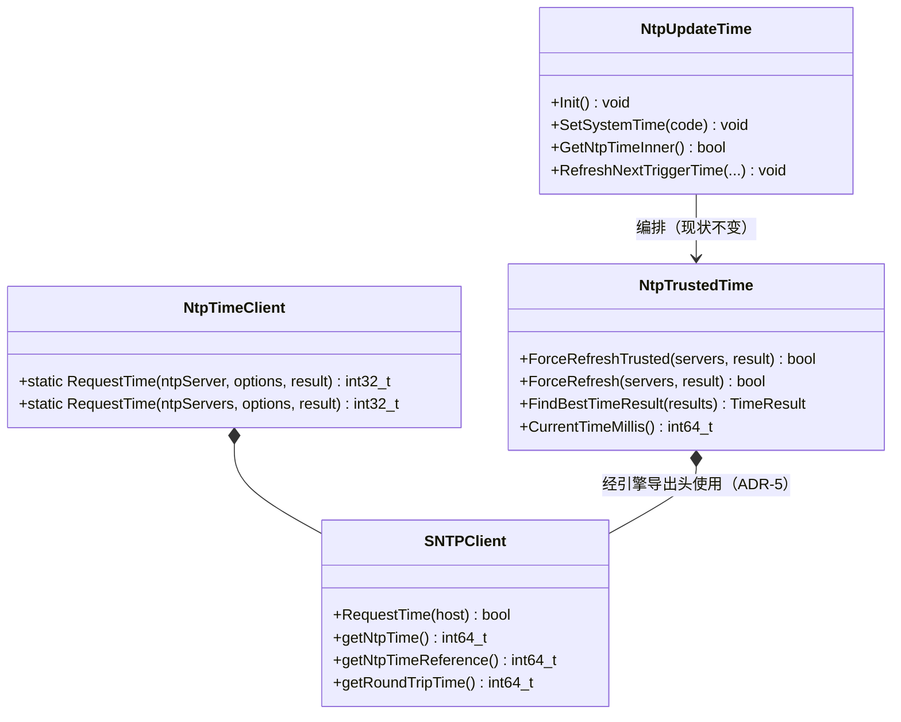

# 架构设计

> 确认架构约束 + 关键设计决策 + 模块影响。行为契约见 spec.md，本文档只给实现路径与决策依据。

## 设计元数据

| 字段 | 内容 |
|------|------|
| Design ID | DESIGN-TBD（关联 draft-20260929-ntp-sync-innerkit） |
| 关联需求 | `proposal.md`（Approved，2026-09-29） |
| 关联 Epic | 无 |
| 目标 Feature | FEAT-TBD（spec.md） |
| 复杂度 | 标准 |
| 目标版本 | OpenHarmony-7.1-Release |
| Owner | TBD |
| 状态 | Approved |

## 需求基线

> 需求基线详见 proposal.md。设计阶段需额外强调的要点：

| 项 | 补充说明 |
|----|------------------|
| 纯 NTP 请求引擎（Q-1/Q-2/Q-8 澄清） | 引擎=**纯 NTP 请求能力**（SNTPClient 迁移 + 批量请求门面）：无调度循环、无网络事件订阅、无 sysparam 监听、无内置默认服务器、**无可信时间机制**（可信名单/可信缓存/按天漂移拒绝均不进引擎）；单次调用语义，重试由调用方负责 |
| 校准策略入引擎（Q-8/Q-9） | 多服务器批量门面内部逐服务器请求并汇总成败，按 `NtpSyncStrategy` 校准策略（第一个成功/往返时延最小/校准投票，可扩展）选定一个 NtpServerResult 返回；可信直取属可信时间策略，不进引擎 |
| 仅返回时间/偏移（Q-3） | 引擎无 settimeofday/RTC 写路径；校时判定（2s 免校、auto_time 开关）与 SetTimeInner 留在 SA 编排层 |
| SA 重构复用（Q-4） | SA 的 NTP 请求能力改由引擎 so 提供（NtpTrustedTime 内部请求来源切换）；可信时间/投票/缓存/编排行为参数不得回退，spec R-8 为验收口径 |

## 上下文和现状

### 涉及仓和模块

| 仓库 | 补充架构说明 |
|------|-------------|
| time_time_service | 单仓变更。NTP 实现现状：`SNTPClient`（纯 SNTP 请求，无 TimeSystemAbility 调用）与 `NtpTrustedTime`（可信判定/投票/缓存，含 hisysevent 上报）均编译于 `libtime_system_ability.so`；按 Q-8 纠偏，**仅 SNTPClient 迁入引擎**，NtpTrustedTime 完整保留在 SA。innerkit 先例 `libtime_client.so`（interfaces/inner_api，innerapi_tags ["platformsdk","sasdk"]）；`time_system_ability_static` 静态库直接编译 sntp_client.cpp（services/BUILD.gn:205），抽取时必须处理该消费者 |

### 代码事实基线

| 代码引用（文件:行/符号） | 已验证事实 | 关联架构规则 | 对本设计的约束 | 验证来源/可信度 |
|-------------------------|------------|--------------|----------------|-----------------|
| `services/time/src/sntp_client.cpp:16-26`（include 块） | SNTPClient 仅依赖 libc/libcutils 系（netdb/securec/sys/time）+ `time_sysevent.h` + `time_hilog.h`；hisysevent 上报点在 `:322`（NTP_REFRESH） | OH-ARCH-LAYERING | SNTPClient 迁入引擎时须摘除 hisysevent 依赖（上报点上移 SA），否则 updater 环境不可用 | 源码，高 |
| `services/time/src/ntp_trusted_time.cpp:16-21, :92/:151`（TimeBehaviorReport NTP_COMPARE_UNTRUSTED；include sntp_client.h + time_sysevent.h） | NtpTrustedTime 依赖 sntp_client + time_sysevent；可信/投票语义与上报交织在信任判定路径内 | OH-ARCH-LAYERING | NtpTrustedTime **完整保留在 SA**（Q-8 纠偏）：其逻辑、锁、上报零改动；仅 sntp_client.h 的引用来源由本仓头改为引擎导出头 | 源码，高 |
| `services/time/src/ntp_update_time.cpp:80-86, :167-204, :258-295, :297-335, :361-398` | NtpUpdateTime 承担全部编排：SA 定时器创建/重排、触发源分发、服务器配置解析（SplitNtpAddrs，上限 NTP_MAX_SIZE=5）、1h 最小间隔、免校 2s、SetTimeInner 校时、sysparam 监听 | OH-ARCH-LAYERING / OH-ARCH-IPC-SAF | 编排层整体保留在 SA 且零改动（Q-8）；其经 NtpTrustedTime 获得 NTP 请求能力 | 源码，高 |
| `services/time/include/sntp_client.h:25`（class SNTPClient） | RequestTime(host) 为无状态单服务器请求：UDP 123、5s 超时、48 字节报文、偏移公式 ((t2−t1)+(t3−t4))/2 | — | 引擎可直接复用该类，接口不动 | 源码，高 |
| `services/time/include/ntp_trusted_time.h:26,32,37,45`（NtpTrustedTime/TimeResult/CurrentTimeMillis） | 可信时间缓存服务 GetNtpTimeMs IPC 查询与 SET_TIME 事件参考时间；缓存与可信机制属 SA 域语义（Q-8：不进引擎） | — | NtpTrustedTime 留 SA：GetNtpTimeMs/GetRealTimeMs 链路零改动 | 源码，高 |
| `services/BUILD.gn:200-233, :212`（time_system_ability_static；静态库编译 sntp_client.cpp） | 静态库直接编译 sntp_client.cpp；其存在意义即 updater 类静态链接场景 | OH-ARCH-COMPONENT-BUILD | 抽取后静态库不得再直接编译该源，改为依赖引擎 source_set，否则双份漂移 | 构建配置，高 |
| `interfaces/inner_api/BUILD.gn:26-40`（time_client target：version_script + innerapi_tags） | innerkit 成熟模式：ohos_shared_library + public 头文件 + lib*.map 导出 + innerapi_tags | OH-ARCH-API-LEVEL | 引擎库沿用同模式 | 构建配置，高 |
| `utils/native/include/time_common.h:45-68`（enum TimeError） | E_TIME_PARAMETERS_INVALID=77856774、E_TIME_NTP_UPDATE_FAILED=77856781 已存在 | OH-ARCH-ERROR-LOG | 引擎错误码直接复用，不新增数值 | 源码，高 |
| `interfaces/inner_api/include/time_service_client.h:429-447`（GetNtpTimeMs/GetRealTimeMs） | IPC 查询面仅这两个 NTP 相关方法，鉴权 systemapp | OH-ARCH-IPC-SAF | 签名/鉴权不动；实现改经引擎缓存与引擎对时 | 源码，高 |

### 调用链层级分析

| 层 | 模块 | 职责 | 修改类型 |
|----|------|------|----------|
| 系统组件层（eupdater，仓外消费方） | — | 提供服务器列表与策略，加载引擎 so 发起对时 | 无（本变更不涉及其仓） |
| InnerKit 层（新增） | ntp_time_client（libtime_ntp_client.so） | SNTP 请求（SNTPClient 迁入）+ 批量请求门面（多服务器重载按策略选定返回）；单次调用、无调度、无缓存；校准策略可扩展 | 新增 |
| 服务编排层（SA 内） | NtpUpdateTime + EventManager | 触发源分发、重试退避定时器、NITZ、配置解析、免校判定、SetTimeInner 校时、sysparam 监听 | 无修改（Q-8 后零改动） |
| 服务核心层（SA 内） | NtpTrustedTime（可信/投票/缓存）、TimeSystemAbility（SetTimeInner/CreateTimer）、GetNtpTimeMs/GetRealTimeMs IPC | 可信时间计算、SA 定时器、IPC 查询 | 修改（仅 sntp_client.h 引用来源切换 + NTP_REFRESH 等价补报） |
| 内核层 | settimeofday / RTC | 系统时间写入 | 无 |

**检查项：**
- [x] 调用链每一层都已覆盖（消费方 → InnerKit → SA 编排 → SA 核心 → 内核）
- [x] 每层职责边界清晰：引擎无写时钟路径、无 SA 框架依赖；校时只在 SA 编排层
- [x] 每层修改类型明确

### 适用架构规则

| Rule ID | 适用原因 | 设计结论 | 验证方式 |
|---------|----------|----------|----------|
| OH-ARCH-LAYERING | 引擎从服务层抽取为 InnerKit | 单向依赖：eupdater/SA → 引擎；引擎不反向依赖服务层；引擎不链接 samgr/ipc/common_event/safwk | 依赖审计（VM-7） |
| OH-ARCH-SUBSYSTEM | 引擎供跨模块（updater 类系统组件）使用 | 经 inner_kits 部件导出，不跨子系统直接引用内部类 | bundle.json 审查 |
| OH-ARCH-IPC-SAF | GetNtpTimeMs/GetRealTimeMs 既有 IPC 面 | 签名、鉴权、Proxy/Stub 与服务端实现全不变（NtpTrustedTime 留 SA） | 存量用例回归（VM-8/VM-9） |
| OH-ARCH-API-LEVEL | 新增 InnerAPI | InnerAPI 级，innerapi_tags 沿用 ["platformsdk","sasdk"]；无 SysCap 新增（复用部件级 SystemCapability.MiscServices.Time） | API 评审 |
| OH-ARCH-COMPONENT-BUILD | 新增 target + inner_kits + 静态库消费方调整 | BUILD.gn 新增引擎 target 与 source_set；bundle.json inner_kits 增条目；time_system_ability_static 改依赖引擎 source_set | 构建验证 |
| OH-ARCH-ERROR-LOG | 错误码与日志 | 复用 TimeError（77856774/77856781）；引擎日志用 hilog（模块标识独立）；DFX 事件经注入回调保留 | 单测 + 事件核对 |

### 既有模式复用

| 模式 | 参考代码（文件:行/符号） | 适用架构规则 | 必须复用的约定 | 本设计的复用方式 | 偏差及理由 | 关联 Task |
|------|-------------------------|--------------|------------------|------------------|------------|-----------|
| innerkit 库模式 | `interfaces/inner_api/BUILD.gn:26-40`（time_client + libtime_client.map + innerapi_tags） | OH-ARCH-API-LEVEL | 库结构、map 导出、tags 写法 | 直接复用 | 无 | TASK-1 |
| 纯引擎源码形态 | `services/time/src/sntp_client.cpp:16-26,322`（迁入引擎）；`ntp_trusted_time.cpp:16-21,92,151`（留 SA，作上报等价核对基准） | OH-ARCH-LAYERING | SNTPClient 类与算法不动 | sntp_client 源码物理迁移至 inner_api | NTP_REFRESH 上报点上移 SA（ADR-1） | TASK-2 |
| updater 静态链接消费 | `services/BUILD.gn:200-316`（time_system_ability_static） | OH-ARCH-COMPONENT-BUILD | 静态库不再重复编译引擎源码 | 静态库 deps 引擎 source_set | 无 | TASK-3 |
| 错误码 | `utils/native/include/time_common.h:45-68` | OH-ARCH-ERROR-LOG | TimeError 枚举与取值 | 直接复用 | 无 | TASK-2 |

## 不涉及项承接

| 维度 | 设计结论 |
|------|----------|
| 安全与权限（proposal=是） | 见"安全基础检查"；结论：未命中高风险判据，不产出 threat-model.md |
| 兼容性 | 引擎为纯新增产物；SA 行为参数逐常量核对不回退（R-8）；静态库链接形态经 source_set 复用保证 |
| API/SDK | 仅新增 InnerAPI `NtpTimeClient::RequestTime`（spec 已固化签名）；无 Public/System API 变化 |
| 构建与部件 | 见"构建系统影响"：新增 `ntp_time_client` shared target + `ntp_time_client_sources` source_set + map + bundle.json inner_kits |

## 关键设计决策

| 决策 ID | 问题 | 推荐方案 | 探索过的替代方案 | 取舍理由 | 影响 |
|---------|------|----------|-----------------|------|------|
| ADR-1 | Q-7（经 Q-8 纠偏简化）：引擎依赖最小化方式 | **纯依赖收敛**：引擎仅含 SNTPClient（迁入）+ NtpTimeClient 批量门面；仅依赖 libc/libcutils/securec/hilog；时钟源直接用 `clock_gettime(CLOCK_BOOTTIME)`；SNTPClient 内的 NTP_REFRESH 上报点（sntp_client.cpp:322）**上移至 SA**（NtpTrustedTime 成功路径等价补报），引擎零 DFX 依赖、零回调机制 | A. DFX 回调注入（reportCallback）：可行但引入不必要接口面，Q-8 后引擎已无其它上报诉求，回调属过度设计；B. 引擎保留 hisysevent 依赖：updater 环境可用性不确定，违反 AC-1.6 | 上报职责归位 SA（其本来就有 TimeBehaviorReport 环境），引擎依赖清单最短，无新增接口概念 | 引擎依赖清单（VM-7）；SA 上报点迁移（INV-5） |
| ADR-2 | Q-6：库名/头文件/导出形态 | 库 `libtime_ntp_client.so`；头文件 `interfaces/inner_api/include/ntp_time_client.h`（类 `NtpTimeClient`，签名以 spec 为准）；SNTPClient 符号随引擎导出（SA 的 NtpTrustedTime 需直接使用）；version_script `libtime_ntp_client.map`；innerapi_tags `["platformsdk","sasdk"]` | A. 沿用需求候选名 libntp_time_client.so：与仓内 libtime_client.so 命名风格不一致；B. tags 仅 sasdk：eupdater 集成形态未定，收窄 tags 可能阻塞消费方 | 与既有 innerkit 命名/tags 惯例一致，导出形态与 time_client 完全同构，评审认知成本低 | BUILD.gn、bundle.json inner_kits |
| ADR-3 | 引擎源码物理位置与迁移范围 | **仅 `sntp_client.{h,cpp}` 迁入** `interfaces/inner_api/`（源 `interfaces/inner_api/src/ntp/`、公开头 `interfaces/inner_api/include/`），SA 与静态库经 target 依赖消费；`ntp_trusted_time.{h,cpp}` **保留在 services/time/**（Q-8） | A. NtpTrustedTime 一并迁入（原方案）：已被需求方 Q-8 否定——"跟可信时间没啥关系"；B. 引擎放 utils/：utils 为纯工具集，承载业务请求门面越界 | InnerKit 自包含是 OH 四层惯例；迁移面最小（单类），SA 逻辑零改动 | 文件迁移清单（execution-plan 展开） |
| ADR-4 | `time_system_ability_static` 与新引擎关系 | 静态库**不再直接编译** sntp_client.cpp（services/BUILD.gn:212），改为 deps `ntp_time_client_sources` source_set，保持静态链接形态给存量消费方 | A. 静态库维持现状编译两份源码：双份漂移，直接违背本需求动机；B. 静态库改链引擎 .so：静态库不能依赖 so，破坏其存在意义 | 单一实现源（引擎），两种链接形态（so/source_set） | services/BUILD.gn 静态库 target |
| ADR-5 | SA 接入方式 | **NtpTrustedTime 请求来源切换**：NtpTrustedTime 内创建/使用 SNTPClient 的代码不变，仅 sntp_client.h 引用来源改为引擎导出（include 适配）+ 其成功路径补报 NTP_REFRESH（等价迁移自 SNTPClient:322）；**NtpUpdateTime 编排零改动**（GetNtpTimeInner/退避/NITZ/免校/SetTimeInner 全不动） | A. NtpUpdateTime 改调引擎批量门面：编排层改动大且违背"最小替换面"；B. SA 双跑灰度：临时方案增加回归面，无长期价值 | 最小替换面：SA 判定/编排代码结构完全不变，仅头文件来源与上报点位置变化，存量单测直接作回归标尺 | ntp_trusted_time.cpp 修改段 |
| ADR-6 | Q-9：接口分层与校准策略集合 | **两层重载**：单服务器重载 `RequestTime(string, options, result)` 原语；多服务器重载 `RequestTime(vector<string>, options, result)` + `NtpSyncStrategy` 枚举（FIRST_SUCCESS=0 / MIN_RTT=1 / VOTE=2，可扩展），返回按策略选定的一个 NtpServerResult。VOTE 实现为纯校准语义：成功候选按偏移互差 ≤100ms 聚类多数表决取 RTT 最优，仅 1 个成功候选直接返回；**不含**可信名单/按天漂移拒绝（依赖可信参考，留 SA） | A. 单层批量返回数组：调用方每次自行实现选择逻辑，eupdater 体验差；B. 策略集含 TRUSTED 直取：把可信时间机制带回引擎，违反 Q-8；C. VOTE 带入 2000ms/天漂移拒绝：该判定依赖可信缓存参考，属可信时间逻辑 | 分层匹配现状代码结构（SNTPClient 即单服务器原语）；校准策略满足"调用方通过策略控制同步方法"的诉求，同时把可信时间边界钉死在 SA | ntp_time_client.h/.cpp 接口面 |

## 设计骨架

### 骨架范围

| 骨架项 | 目标 | 不包含 | 验证方式 |
|--------|------|--------|----------|
| API/接口骨架 | `ntp_time_client.h`：两个 `RequestTime` 重载（单服务器/多服务器）精确签名 + `NtpSyncStrategy` 枚举 + `NtpTimeOptions`（strategy/超时）+ `NtpServerResult` | 引擎内部请求实现（二期迁移） | 编译 + 头文件快照 |
| 模块骨架 | `libtime_ntp_client.so` target + source_set + map + bundle.json inner_kits 条目 | SA 重构接入 | hb 构建通过 |
| 测试骨架 | 引擎 gtest fixture（Mock UDP 网络）+ 参数校验用例 | 全场景 | VM-1/VM-5 最小用例通过 |

### 骨架 Spec 拆分

| Task ID | 目标 | 受影响文件 | AC |
|---------|------|------------|-----|
| TASK-SKELETON-1 | 建立引擎 InnerAPI 骨架（头文件+options/result 类型+空实现返回参数错误） | interfaces/inner_api/include/ntp_time_client.h、src/ntp_time_client.cpp、BUILD.gn、map、bundle.json | WHEN 以空列表调用 RequestTime THEN 返回 E_TIME_PARAMETERS_INVALID（77856774）且不发起网络请求（AC-1.5 骨架级） |

## 后续 Task 拆分

> design.md 以 proposal.md 和 spec.md 为上游输入；本节描述 design 输出到 Plan 阶段的衔接信息。

| Task ID | 目标 | 受影响文件 | 依赖 |
|---------|------|------------|------|
| TASK-1 | InnerKit 骨架落地（ADR-2/ADR-3 target 与导出） | interfaces/inner_api/BUILD.gn、bundle.json、libtime_ntp_client.map、ntp_time_client.h/.cpp | spec.md；骨架评审 |
| TASK-2 | 引擎核心落地（SNTPClient 迁入 + 批量门面 + 上报点摘除，ADR-1/ADR-3） | interfaces/inner_api/src/ntp/*、services/time/ 迁移删除、services/BUILD.gn | TASK-1 |
| TASK-3 | SA 适配（NtpTrustedTime 头来源切换 + NTP_REFRESH 等价补报 + 静态库 source_set，ADR-4/ADR-5） | services/time/src/ntp_trusted_time.cpp、services/BUILD.gn | TASK-2 |
| TASK-4 | 测试补齐：引擎单测（VM-1~VM-7）+ 存量回归（VM-8/VM-9）+ fuzzer 迁移核对 | test/unittest/、test/fuzztest/ | TASK-2/TASK-3 |

## API 签名、Kit 与权限

### 新增 API

| API 签名 | 类型 | Kit | d.ts 位置 | 权限 | SysCap |
|----------|------|-----|-----------|------|--------|
| 单服务器重载：`static int32_t NtpTimeClient::RequestTime(const std::string& ntpServer, const NtpTimeOptions& options, NtpServerResult& result)`；多服务器重载：`static int32_t NtpTimeClient::RequestTime(const std::vector<std::string>& ntpServers, const NtpTimeOptions& options, NtpServerResult& result)`（spec.md 已固化；头文件 `interfaces/inner_api/include/ntp_time_client.h`；SNTPClient 类符号随引擎导出供 SA 的 NtpTrustedTime 使用） | InnerApi | libtime_ntp_client.so | N/A（无 d.ts，进程内 C++） | 无（引擎不校时不需权限；调用方自控） | 复用部件级 SystemCapability.MiscServices.Time，不新增 |

**NtpSyncStrategy 枚举（设计冻结，ADR-6）：**

| 枚举值 | 数值 | 语义 |
|--------|------|------|
| FIRST_SUCCESS | 0 | 第一个成功候选即返回 |
| MIN_RTT | 1 | RTT 最小的成功候选 |
| VOTE | 2 | 校准投票：成功候选按偏移互差 ≤100ms 聚类多数表决取 RTT 最优；仅 1 个成功候选直接返回（纯校准语义，不含可信名单/漂移拒绝） |

**NtpTimeOptions 字段（设计冻结，spec 参数约束承接）：**

| 字段 | 类型 | 必填 | 默认 | 说明 |
|------|------|------|------|------|
| strategy | NtpSyncStrategy | 多服务器重载必填 | — | 仅多服务器重载使用；单服务器重载无策略 |
| perRequestTimeoutMs | uint32_t | 否 | 5000 | 单次请求超时上限 |

> 引擎接口**不含**可信名单/缓存/漂移拒绝等可信时间语义（Q-8/Q-9）：策略枚举仅含校准语义且可扩展。

**NtpServerResult 字段：** server / success / ntpTimeMillis / clockOffsetMs / roundTripTimeMs / errCode（失败原因）。

### 变更/废弃 API

| 原有 API | 变更类型 | 新 API | 迁移说明 |
|----------|----------|--------|----------|
| N/A：无签名级变更 | — | — | GetNtpTimeMs/GetRealTimeMs 及 JS 面不变（NtpTrustedTime 留 SA，链路零改动） |

## 构建系统影响

### BUILD.gn 变更

```
文件路径: interfaces/inner_api/BUILD.gn
变更说明: 新增 ohos_shared_library("ntp_time_client")（libtime_ntp_client.so，version_script=libtime_ntp_client.map，
          innerapi_tags=["platformsdk","sasdk"]）+ ohos_source_set("ntp_time_client_sources")（供 SA 与静态库复用同一批源）；
          源文件来自 interfaces/inner_api/src/ntp/（由 services/time/ 迁入）

文件路径: services/BUILD.gn
变更说明: ohos_shared_library("time_system_ability") 源列表移除 sntp_client.cpp（:92），
          deps 新增 //base/time/time_service/interfaces/inner_api:ntp_time_client_sources；
          ohos_static_library("time_system_ability_static") 同步移除该源（:212）并 deps 同一 source_set（ADR-4）。
          NtpTrustedTime/NtpUpdateTime 源保留在 time_system_ability 源列表不变。
```

### bundle.json 变更

inner_kits 新增条目（沿用 time_client 条目结构）：

```json
{
  "name": "//base/time/time_service/interfaces/inner_api:ntp_time_client",
  "header": { "header_base": "//base/time/time_service/interfaces/inner_api/include", "header_files": ["ntp_time_client.h"] },
  "type": "so"
}
```

部件 deps 无新增外部依赖（引擎依赖仅 libc/libcutils/securec/hilog，均为存量）。

---

## 可选设计扩展

### 架构图

```
[eupdater 进程] ──链接──> [libtime_ntp_client.so]（引擎：SNTP 请求 + 批量门面，多服务器重载按策略选定返回）
                              │ 仅 libc/libcutils/securec/hilog
[time_service SA] ──请求来源──> NtpTrustedTime（可信/投票/缓存，留 SA）──使用──> SNTPClient（引擎导出）
                              └──编排──> NtpUpdateTime（触发源/退避/NITZ/免校/校时，零改动）
[time_system_ability_static] ──deps source_set──> ntp_time_client_sources
```

### 类图



| 类型/接口 | 现有代码引用或 New | 关系 | 关键职责/签名 | 关联 ADR | 关联 Task |
|-----------|--------------------|------|---------------|----------|-----------|
| NtpTimeClient | New | 门面，组合 SNTPClient | 两层 RequestTime 重载（spec 固化签名）；参数校验（R-5）、多服务器重载校准策略选择（R-3，枚举可扩展）、错误码映射；**无可信时间逻辑** | ADR-2/6 | TASK-1/2 |
| SNTPClient | `services/time/src/sntp_client.cpp:25`（迁入 inner_api/src/ntp/，符号导出） | 被 NtpTimeClient 与 SA 的 NtpTrustedTime 共同使用 | 单服务器 SNTP 请求与偏移计算，接口不动；NTP_REFRESH 上报点移除（移至 SA） | ADR-1/3 | TASK-2 |
| NtpTrustedTime | `services/time/src/ntp_trusted_time.cpp`（**留 SA**） | 持有 SNTPClient（经引擎导出） | 可信接受/投票/缓存（CurrentTimeMillis 1 天失效）逻辑零改动；成功路径补报 NTP_REFRESH | ADR-5 | TASK-3 |
| NtpUpdateTime | `services/time/src/ntp_update_time.cpp`（留在 SA） | 依赖 NtpTrustedTime | 编排零改动（Q-8 后无引擎直接调用） | ADR-5 | 回归（TASK-4） |
| NtpTimeOptions / NtpServerResult | New（ntp_time_client.h） | 值类型 | 字段见"API 签名"节 | ADR-2 | TASK-1 |

### 数据流/控制流

| 步骤 | 调用方 | 被调用方 | 数据/接口 | 说明 |
|------|--------|----------|-----------|------|
| 1 | eupdater | NtpTimeClient::RequestTime（单服务器或多服务器重载） | ntpServer(s) + options | 入参校验（R-5），非法直接返回 77856774 |
| 2 | NtpTimeClient | SNTPClient::RequestTime（逐服务器） | UDP:123 | 单次 5s 超时；逐服务器成败记录（多服务器重载内部） |
| 3 | NtpTimeClient | → 返回 | NtpServerResult | 单服务器重载=该服务器结果；多服务器重载=按 strategy 选定（FIRST_SUCCESS/MIN_RTT/VOTE 校准投票）；无成功候选返回 77856781（R-4）；无写时钟（INV-1） |
| 4 | NtpUpdateTime（SA 路径） | NtpTrustedTime::ForceRefresh{,Trusted} + FindBestTimeResult | 服务器配置（persist.time.ntpserver*） | 可信/投票/缓存逻辑（留 SA，零改动） |
| 5 | NtpTrustedTime | SNTPClient::RequestTime（引擎导出） | 每服务器 UDP:123 | 请求来源由本仓头切换为引擎导出（ADR-5）；成功后补报 NTP_REFRESH（等价迁移自 sntp_client.cpp:322） |
| 6 | NtpUpdateTime | CheckNeedSetTime → SetTimeInner | TimeResult | 免校 2s 判定后校时（校时职责不在引擎；NITZ/退避不变） |

### 状态归属与不变量

#### 状态归属

| State ID | 状态/资源 | 唯一 Owner | 存储/Key/Index | 创建与初始化 | 读取/更新方 | 清理/恢复/回滚触发 | 并发模型 | 代码事实/规则来源 |
|----------|-----------|------------|----------------|------------|-------------|--------------------|----------|-------------------|
| STATE-1 | 可信时间缓存（mNtpTime/mNtpTimeReference + 1 天失效） | NtpTrustedTime（**SA 内单例，留 SA**） | 静态成员 | 第一次成功对时写入 | CurrentTimeMillis() 读取（GetNtpTimeMs/GetRealTimeMs 链路） | 1 天失效自动失效；Stop/进程退出 | 现状锁模型不变（本变更不迁移该类） | `ntp_trusted_time.h:26,32` + spec R-8 |
| STATE-2 | UDP socket（单次请求生命周期） | SNTPClient 每次 RequestTime 栈对象 | 局部 | 请求时创建 | 无共享 | 请求结束即关闭（RAII/显式 close，现状语义） | 调用线程封闭 | `sntp_client.cpp` |
| STATE-3 | SA 编排行为参数（退避 10s×4→12h、最小间隔 1h、免校 2s、NITZ 12h 等常量） | NtpUpdateTime（SA 编排层） | `ntp_update_time.cpp` 常量与成员 | SA 启动初始化 | NtpUpdateTime 内部 | 进程退出 | 现状锁模型不变 | `ntp_update_time.cpp:297-335` + spec R-8 |

#### 不变量追溯

| Invariant ID | State ID / 范围 | 必须始终成立的约束 | 关联 AC | 关联 Task | 验证方式与通过标准 | 违反时处理 |
|--------------|------------------|--------------------|---------|-----------|--------------------|------------|
| INV-1 | 引擎全局 | RequestTime 任意路径（含异常）不得调用 settimeofday/时钟写接口 | AC-1.1/AC-1.4 | TASK-2 | 单测 Mock 监控零调用（VM-6）；代码审查 | 拒绝合入 |
| INV-2 | STATE-1 / STATE-2 / 引擎构建依赖 | 引擎 so 的链接依赖不得含 samgr/ipc/common_event/safwk/hisysevent | AC-1.6 | TASK-1 | 依赖审计清单（VM-7） | 拒绝合入 |
| INV-3 | STATE-1 | 缓存对 GetNtpTimeMs/GetRealTimeMs 的返回行为与重构前一致（含 1 天失效） | AC-2.2 | TASK-3 | 存量 time_client_test.cpp NTP 用例全绿 | 回滚该 Task |
| INV-4 | STATE-3 | R-8 行为参数（退避/1h/2s/NITZ 12h）常量值不回退 | AC-2.1 | TASK-3 | 存量 time_service_time_test.cpp NTP 用例全绿 + 常量 diff 审查 | 回滚该 Task |
| INV-5 | STATE-1 / STATE-2 | NTP_REFRESH 上报点从 SNTPClient（sntp_client.cpp:322）迁移至 SA（NtpTrustedTime 成功路径）后，事件码、入参、触发时机与现状一致；NTP_COMPARE_UNTRUSTED（ntp_trusted_time.cpp:92,151）不受影响 | AC-2.1 | TASK-2/3 | 事件注入测试 + 存量事件断言 | 修正迁移点 |

### 算法与状态机

无新增状态机。引擎为"单次调用"语义：入口校验（R-5）→ 逐服务器 SNTP 请求 → 逐服务器成败汇总 → 返回（≥1 成功返回 0，全失败 77856781）；无跨调用状态（STATE-1 缓存属 SA 的 NtpTrustedTime，本变更不迁移）。

### 资源所有权矩阵

| 资源 / State ID | 创建方 | 持有方（Owner） | 借用/只读消费者 | 销毁触发 | 实际释放 | 异常回收 | 关联不变量 |
|-----------------|--------|----------------|-----------------|----------|----------|----------|------------|
| 可信时间缓存 / STATE-1 | NtpTrustedTime（第一次成功对时） | NtpTrustedTime 引擎单例 | SA 侧 GetNtpTimeMs/GetRealTimeMs 链路（只读） | 1 天失效 / 进程退出 | NtpTrustedTime 静态成员析构 | 失效后 CurrentTimeMillis 返回未同步语义（与现状一致） | INV-3 |
| UDP socket / STATE-2 | SNTPClient::RequestTime | 单次调用栈 | 无 | 请求结束（含超时/失败） | RequestTime 出口 close | 超时路径兜底 close，无泄漏（INV-1 异常路径同样无写时钟副作用） | INV-1 |
| 引擎 so 依赖边界 / 构建期资源 | BUILD.gn target | libtime_ntp_client.so | eupdater（运行时链接）、SA、静态库（编译期） | 部件卸载 | 构建系统 | 依赖审计拦截违规依赖 | INV-2 |

### 线程与并发模型

引擎单次调用为调用线程封闭（无跨调用共享可变状态）；SA 编排层并发模型不变（requestMutex_ 串行化 SetTimeTime，ntp_update_time.cpp 现状）。本变更对 SA 并发的唯一影响点：NtpTrustedTime 使用 SNTPClient 的 include 来源变化（无并发语义变化），NTP_REFRESH 补报线程归属与现状一致（SNTPClient 调用线程）。SA 行为参数（STATE-3）与可信缓存（STATE-1）的并发约束分别由 INV-4、INV-3 的存量用例保证。

| 场景 | 竞争对象 | 保护机制 | 预期行为 | 关联 AC/Task | 验证方式 |
|------|----------|----------|----------|-------------|----------|
| SA 并发触发源同时进入 SetSystemTime | 编排状态（STATE-3） | requestMutex_（现状） | 串行执行，行为参数不退化 | AC-2.1 / TASK-4 | 存量并发用例回归（INV-4） |
| 可信缓存查询与对时写缓存并发 | STATE-1（NtpTrustedTime，SA） | NtpTrustedTime 现状锁 | 读不阻塞写完成，返回语义不变 | AC-2.2 / TASK-4 | 存量用例回归（INV-3） |
| eupdater 并发调用引擎 | 无共享状态 | 调用线程封闭 | 各调用独立，无竞争 | AC-1.1 / TASK-2 | 引擎单测并发用例 |

### 测试性设计

| 测试层级 | 测试目标 | Mock 策略 | 验证方式 |
|----------|----------|-----------|----------|
| 单元测试（引擎） | VM-1~VM-6：合法/投票/非投票/全失败/参数/无写时钟 | Mock UDP socket 层（netdb/socket 封装点）+ settimeofday 监控 | `test/unittest` 新增 ntp_engine 测试集，gtest |
| 单元测试（SA 回归） | VM-8/VM-9：存量 NTP 用例全绿、IPC/JS 面不变 | 存量 fixture | 存量 gtest 全量回归 |
| 依赖审计 | VM-7：引擎 so 依赖清单 | N/A | 构建产物依赖扫描（人工/脚本） |
| Fuzzer | timesntp_fuzzer/timentptime_fuzzer 随源码迁移核对 | N/A | fuzz 构建通过 |

### 安全基础检查

#### 信任边界交叉分析

| 边界类型 | 跨越的交互 | 风险 | 约束 |
|---|---|---|---|
| 本地/远程 | 引擎向调用方提供的 NTP 服务器发 UDP 123 请求 | 中间人伪造时间报文 → 错误校时决策 | 沿用现有 SNTP 校验（报文合法性/origin 回显）；投票/可信名单机制防单点伪造；引擎不直接校时，最终决策在 SA 免校/开关保护下 |
| 沙箱内外 | innerkit 被系统组件（eupdater）进程内加载 | 不可信应用获取引擎 | innerapi_tags 限定 platformsdk/sasdk 导出，不面向应用 |
| 用户态/内核态 | 无（引擎不涉内核态写） | — | INV-1 |
| 不同 SELinux 域 | eupdater 域加载 so | 域权限 | 引擎无特权依赖（无 setuid/无设备节点/无特权 IPC） |

#### 基础安全要求

| 检查项 | 结论 | 说明/措施 |
|---|---|---|
| 加密算法(OH 推荐) | N/A | NTP/SNTP 为明文 UDP 协议，引擎不引入加密；无密钥 |
| 密钥管理 | N/A | 无密钥 |
| 随机数 | N/A | 无随机数使用 |
| 输入验证 | 是 | R-5：列表非空/格式/上限 5；入参校验前置零发包 |
| 错误处理 | 是 | 错误码收敛（77856774/77856781），失败路径无残留 socket（STATE-2 RAII） |
| 配置 | N/A | 引擎无自有配置读取（配置解析在 SA 编排层，不变） |
| 敏感数据处理(传输/存储/日志) | 无敏感数据 | 引擎不处理用户数据；日志仅服务器地址与偏移值 |

### 深度威胁分析(如需)

未命中高风险判据（无敏感数据存储、无认证授权面、无网络监听端口、引擎不直接改系统时间且有 SA 侧免校/开关双重保护），**不产出 threat-model.md**。如 SIG 评审认为 innerkit 开放范围需收紧，重开本节评估。

## 风险和开放问题

| 项 | 类型 | 影响 | 处理方式 | Owner |
|----|------|------|----------|-------|
| updater 环境 hilog 可用性 | 运行 | 中 | 引擎日志依赖 hilog（ADR-1 保留）；plan 阶段在 eupdater 集成前以依赖审计 + 最小环境冒烟（VM-7）验证，不可用时降级方案：日志宏开关（引擎编译参数控制） | TBD |
| SNTPClient/NtpTrustedTime 迁移后历史 bugfix 同步 | 技术 | 中 | 迁移以"物理移动+最小改动"为原则（git mv 保历史）；迁移后 diff 必须仅含 hisysevent→回调、include 路径变化 | TBD |
| `time_system_ability_static` 是否有仓外隐性消费方依赖其内嵌 NTP 符号 | 构建 | 低 | 该库 symbols 全 local（version_script 全隐藏），消费方只能整体静态链接；改 source_set 后对外可见性不变 | TBD |
| NTP_REFRESH 上报点迁移引入的时序差异 | 技术 | 低 | INV-5 事件注入测试 + 存量事件断言兜底；NTP_COMPARE_UNTRUSTED 路径不受影响（NtpTrustedTime 未动） | TBD |
| Q-6/Q-7 在 design 已决策，若 SIG 评审推翻命名/解耦方案 | 架构 | 中 | 重开 design 评审并同步刷新 spec 事实表（库名/签名） | TBD |

## 设计审批

- [x] 需求基线已确认，设计覆盖 P0/P1 AC（AC-1.1~AC-1.6、AC-2.1、AC-2.2 均有对应决策/Task）
- [x] 不涉及项已承接，N/A 和展开项都有结论
- [x] 涉及仓和模块职责清楚（单仓：time_time_service；eupdater 为仓外消费方）
- [x] 调用链层级分析完整，每层覆盖到位
- [x] 涉及既有实现时，代码事实基线使用文件:行/符号引用，且每项事实已转化为设计约束
- [x] 已检索并记录既有模式复用（innerkit 模式/纯引擎源码/静态库先例/错误码）
- [x] 适用架构规则已识别并形成设计结论
- [x] 分层和子系统边界合规（单向依赖：消费方→引擎；SA→引擎）
- [x] 命中类/接口关系触发条件时，类图与代码事实、ADR、Task 一致
- [x] 涉及状态/资源/并发时，状态 Owner 唯一，生命周期、恢复和锁/消息模型无冲突
- [x] 每项 `INV-*` 均关联 AC、Task 和可执行验证方式，状态机/资源/并发章节引用一致
- [x] API 变更有签名、权限、错误码和兼容性说明
- [x] BUILD.gn/bundle.json 影响明确
- [x] 设计输出和后续 Task 拆分明确（TASK-1~TASK-4 + 骨架任务）
- [x] 关键设计决策有理由和影响说明（ADR-1~ADR-5）
- [x] 风险和开放问题有 Owner

**结论:** 通过（2026-09-29 需求方确认基线；ADR-1/ADR-2 命名与解耦方案按推荐方案定案）
